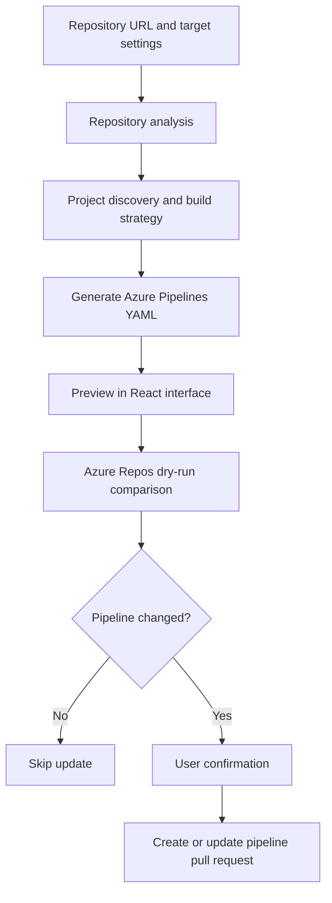

# AutoPipeline Generator

**Automate CI/CD pipeline preparation, from repository analysis to a reviewable Azure DevOps pull request.**

AutoPipeline Generator was built to reduce the repetitive work of writing and maintaining CI/CD configuration for different applications. It analyzes a repository, identifies its technology and build requirements, and generates Azure Pipelines YAML with build, artifact publishing and deployment steps.

A React interface brings repository settings, deployment options and YAML previews into one workflow. Teams can review the generated configuration before submitting it to Azure Repos through a confirmed pull request.

## Why this project exists

Setting up CI/CD often means repeating the same work: inspecting project files, selecting build tools, configuring artifacts and adapting deployment scripts to a server. That work becomes harder to maintain across repositories using different technologies.

This project turns those steps into a repeatable workflow. Its goal is to make CI/CD setup faster and more consistent while keeping generated pipeline changes visible in code review.

## Features

- **Repository analysis:** discover projects, detect languages and inspect build files and package managers.
- **Build strategy selection:** generate build steps using Railpack, an existing Dockerfile or .NET project configuration.
- **Pipeline generation:** produce Azure Pipelines YAML with build, artifact publishing and deployment jobs.
- **Multiple deployment targets:** configure Linux containers, IIS applications and Windows Services.
- **Interactive previews:** inspect generated YAML before requesting remote changes.
- **Azure Repos integration:** compare existing pipeline content, skip unchanged YAML and reuse an existing pull request when appropriate.
- **Confirmation before writes:** run a dry-run comparison before allowing branch, commit and pull request operations.

## Workflow



The current application automates analysis, YAML generation and pull request preparation. Pipeline registration, execution and successful deployment require Azure DevOps configuration, compatible agents, credentials and the target infrastructure. Real-world end-to-end deployment has not been established by the local regression tests.

## Supported targets

| Target | Generated workflow | Key settings |
| --- | --- | --- |
| Linux container | Build a container image, publish an image artifact and deploy to a Linux agent | Container and host ports, agent pool, architecture, health URL |
| IIS | Publish a .NET application and deploy it to an IIS destination | Project/framework, application pool, site path, health URL |
| Windows Service | Publish a .NET application and deploy it as a Windows Service | Project/framework, service name, installation path, optional health URL |

Repository preview accepts supported HTTPS GitHub and Azure Repos URLs. Pull request automation currently targets Azure Repos. Private repository access depends on credentials available to the backend's Git and Azure CLI processes.

## Architecture

| Component | Responsibility |
| --- | --- |
| FastAPI | Repository analysis, pipeline preview and pull request API |
| Repository analyzer | Language detection, project discovery and build evidence |
| Pipeline orchestrator | Resolve configuration and coordinate YAML generation |
| Build generators | Railpack, Dockerfile and .NET CI steps |
| Deployment generators | Linux container, IIS and Windows Service steps |
| Azure DevOps integration | Repository discovery, YAML comparison and pull request operations through Azure CLI |
| React + Vite | Deployment configuration, YAML preview and confirmation flow |

```text
backend/                 API, analysis, generation and Azure DevOps integration
  data/languages.yml     Language detection definitions
frontend/                React interface and Vite configuration
tests/                   Regression tests and supplementary checks
config.yaml              Example generator configuration
```

## Getting started

### Prerequisites

- Python 3.11 or later; the backend uses `tomllib`.
- Node.js and npm compatible with the versions in `frontend/package-lock.json`.
- Git for repository cloning.
- Railpack for workflows that use Railpack analysis.
- Azure CLI with Azure DevOps support for repository discovery and pull request operations.
- Docker and compatible deployment agents where the generated container pipelines execute.

### Backend

From the project root:

```sh
python3 -m venv .venv
source .venv/bin/activate
python -m pip install fastapi pydantic PyYAML GitPython uvicorn
python -m uvicorn backend.main:app --host 127.0.0.1 --port 8002
```

On Windows, activate the environment with `.venv\Scripts\Activate.ps1` in PowerShell.

Backend dependencies are not yet pinned in a dependency manifest. The installation command lists the backend's direct third-party imports and its ASGI server; it is a starting point rather than a reproducible, version-locked environment.

The API is available at `http://localhost:8002`; interactive API documentation is available at `http://localhost:8002/docs`.

### Frontend

In a separate terminal:

```sh
cd frontend
npm ci
npm run dev
```

Open the local URL printed by Vite. The frontend currently calls `http://localhost:8002`, and backend CORS allows local frontend ports 5173 and 5174.

### Azure DevOps access

Configure Azure CLI authentication and organization defaults locally before using Azure Repos operations. Git must also have access to the selected repository. Keep authentication material outside the repository.

The backend invokes external tools with the permissions of the local process. Run it in a trusted local environment; it does not currently provide application-level authentication for shared public hosting.

## Usage

1. Enter the repository URL and branch.
2. Select a deployment target and supply its required settings.
3. Generate and inspect the YAML preview.
4. For Azure Repos, provide the Azure DevOps project and repository name, then request a dry-run comparison.
5. Confirm the proposed change to create or update a pipeline pull request.
6. Review and merge the pull request through your team's normal process, then configure and run the Azure pipeline in the target environment.

`config.yaml` provides an example Linux container configuration for programmatic generation. Review its project name, branch and agent pool before use. API requests supply their own repository and deployment settings.

## API endpoints

| Method | Endpoint | Purpose |
| --- | --- | --- |
| GET | `/health` | Check backend health |
| POST | `/analyze` | Analyze a repository using `repo_url` |
| POST | `/api/pipeline/preview` | Generate YAML from repository and deployment settings |
| POST | `/api/pipeline/pr` | Compare pipeline content or perform confirmed Azure Repos updates |

For request schemas and optional target-specific fields, use the FastAPI documentation at `/docs`. Pull request requests default to `dry_run: true`; write operations require `dry_run: false` and `confirmed: true`.

## Development and validation

Run the Python regression suite:

```sh
PYTHONDONTWRITEBYTECODE=1 python -B -m unittest discover -s tests -v
```

Run the supplementary configuration checks, which standard unittest discovery does not collect:

```sh
PYTHONDONTWRITEBYTECODE=1 python -B - <<'PYTHON'
from pathlib import Path
import runpy

for script in sorted(Path("tests").glob("check_*.py")):
    runpy.run_path(str(script), run_name="__main__")
PYTHON
```

Run frontend checks:

```sh
npm --prefix frontend run lint
npm --prefix frontend run build
```

The regression suite covers build selection, startup commands, runtime settings, YAML generation, deployment validation and API/pull request behavior. External operations are mocked where applicable; these checks do not replace testing on real deployment infrastructure.

## Credentials and local files

Never commit `.env` files, API keys, PATs, passwords, private keys or CLI credential stores. Frontend source and any `VITE_*` environment variables are public and must not contain secrets.

The root `.gitignore` excludes local credentials, virtual environments, dependencies, caches, backups, generated pipeline artifacts and environment-specific investigation reports. Review the staged file list and run a secret scanner before publishing changes.
